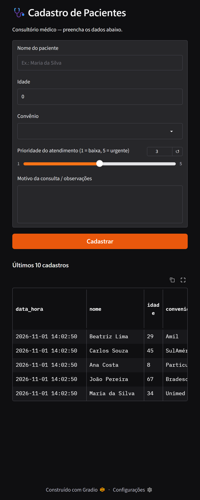

# Cadastro de Pacientes — Gradio × Streamlit

A mesma interface de cadastro de pacientes de um consultório médico, construída duas vezes
para comparar as bibliotecas. Os dados são gravados em `pacientes.csv`.

Campos: nome (texto), idade (número), convênio (seleção), prioridade (slider 1–5) e
motivo da consulta / observações (texto).

| Pasta | Biblioteca | Execução |
|---|---|---|
| [`gradio_app/`](gradio_app) | Gradio (`gr.Blocks`, `gr.Dataframe`) | local |
| [`streamlit_app/`](streamlit_app) | Streamlit (`st.form`, `st.session_state`, `st.download_button`) | Streamlit Community Cloud |

**App público (Streamlit Cloud):** https://aplicacoesdatascience-bvnxenbspubsk4thgkmix4.streamlit.app/

## Rodar localmente

```bash
cd DataScience
pip install -r gradio_app/requirements.txt

# Gradio -> http://127.0.0.1:7860
python gradio_app/app.py

# Streamlit -> http://localhost:8501
streamlit run streamlit_app/app.py
```

## Deploy no Streamlit Community Cloud

1. Acesse [share.streamlit.io](https://share.streamlit.io) e entre com a conta do GitHub.
2. **Create app** → repositório `RPegoli/AplicacoesDataScience`, branch `main`,
   arquivo principal `DataScience/streamlit_app/app.py`.
3. **Deploy**. O `requirements.txt` da pasta do app é instalado automaticamente.

O armazenamento no Streamlit Cloud é efêmero (o CSV do servidor some quando o app reinicia),
por isso o app oferece o botão **Baixar pacientes.csv**.

## Entregáveis

- Print da interface Gradio local: [`docs/gradio_local.png`](docs/gradio_local.png)
- CSV de exemplo: [`gradio_app/pacientes.csv`](gradio_app/pacientes.csv)


